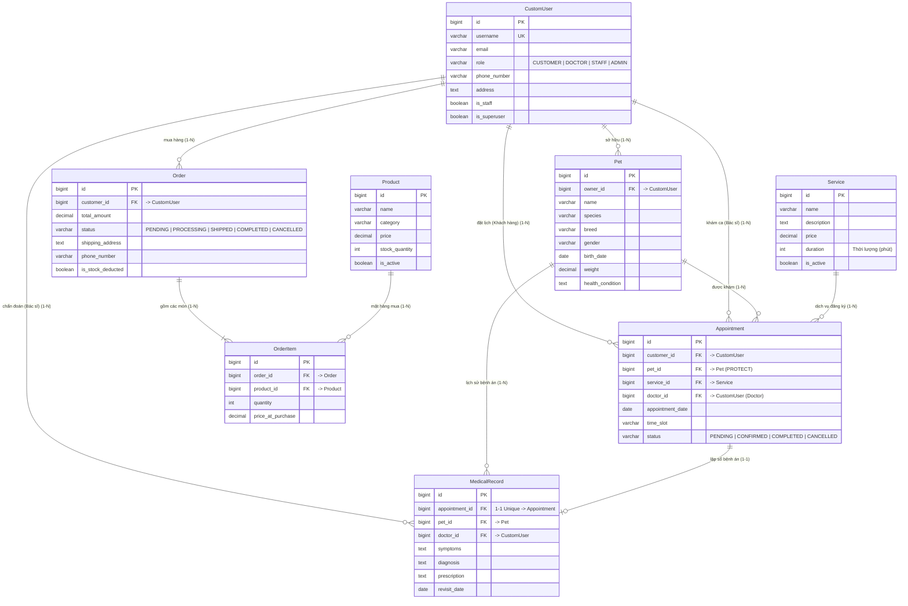

# 🐾 Website Trung Tâm Thú Y (Veterinary Center Web Application)

> **Học phần:** Lập trình Website (Mã HP: 012012103105)  
> **Trường:** Trường Đại học Giao thông vận tải TP. Hồ Chí Minh (UTH)  
> **Tập thể thực hiện:** Nhóm 2  
> **Chủ trì Hạ tầng & Core Backend (TV1):** Leader / Core Backend & DevOps  

---

## 📑 MỤC LỤC TỔNG HỢP NỘI DUNG

1. [Giới thiệu Dự án & Kiến trúc Công nghệ](#-1-giới-thiệu-dự-án--kiến-trúc-công-nghệ-tech-stack)
2. [Hướng dẫn Cài đặt & Chạy Docker Toàn Tập (A - Z)](#-2-hướng-dẫn-cài-đặt--chạy-docker-toàn-tập-a---z)
3. [Cấu trúc Dockerfile & docker-compose.yml (Hạ tầng Container)](#-3-cấu-trúc-dockerfile--docker-composeyml-hạ-tầng-container)
4. [Mô hình Dữ liệu Django Models & Sơ đồ ERD Chuẩn hóa](#-4-mô-hình-dữ-liệu-django-models--sơ-đồ-erd-chuẩn-hóa)
5. [Hàng đợi Xử lý Bất đồng bộ Celery & Redis](#-5-hàng-đợi-xử-lý-bất-đồng-bộ-celery--redis)
6. [Cấu trúc Thư mục Dự án (Kiến trúc Django MVT)](#-6-cấu-trúc-thư-mục-dự-án-kiến-trúc-django-mvt)
7. [Phân công Công việc Nhóm & Quy định Gitflow](#-7-phân-công-công-việc-nhóm--quy-định-gitflow)
8. [Sổ tay Tra cứu Lệnh Thường dùng (Cheatsheet)](#-8-sổ-tay-tra-cứu-lệnh-thường-dùng-cheatsheet)

---

## 📌 1. Giới thiệu Dự án & Kiến trúc Công nghệ (Tech Stack)

Dự án **Website Trung Tâm Thú Y** là hệ sinh thái web phục vụ quản lý hồ sơ thú cưng, đặt lịch khám trực tuyến, bệnh án điện tử cho bác sĩ và bán hàng sản phẩm thú cưng thanh toán COD.

Hệ thống được đóng gói container hóa đồng bộ gồm **4 dịch vụ độc lập**:
- **Application Server (`web`):** Python 3.11+, Django Framework 4.2+ (Kiến trúc MVT - Model View Template), cổng `8000`.
- **Cơ sở dữ liệu quan hệ (`db`):** MySQL 8.0 Containerized (bảng mã `utf8mb4_unicode_ci`), map cổng host `3307:3306` (tránh xung đột với MySQL/XAMPP cài sẵn trên máy).
- **Bộ đệm & Broker (`redis`):** Redis 7.x Alpine, cổng `6379`.
- **Hàng đợi tác vụ ngầm (`celery`):** Celery Worker 5.x kết nối Redis, tự động gửi Email xác nhận và nhắc lịch hẹn trước 24h chạy nền.

---

## 🐳 2. Hướng dẫn Cài đặt & Chạy Docker Toàn Tập (A - Z)

Phần này hướng dẫn chi tiết từng bước để bất kỳ thành viên nào (kể cả chưa từng dùng Docker) cũng có thể cài đặt và khởi chạy hệ thống mượt mà:

### 2.1. Cài đặt Docker Desktop trên máy tính
1. **Dành cho Windows 10 / 11:**
   - Tải bộ cài chính thức tại: [https://www.docker.com/products/docker-desktop/](https://www.docker.com/products/docker-desktop/)
   - Khi cài đặt, bắt buộc tích chọn: **"Use WSL 2 instead of Hyper-V"** (Khuyến nghị để đạt hiệu năng tối đa).
   - Nếu máy báo thiếu nhân Linux WSL2, mở PowerShell với quyền Administrator và gõ:
     ```powershell
     wsl --update
     ```
     Sau đó khởi động lại máy tính.
   - Mở ứng dụng **Docker Desktop**, đợi biểu tượng góc dưới thanh Taskbar chuyển sang màu xanh lá (*Docker Engine running*).
2. **Dành cho macOS:** Tải bản cài tương ứng (Chip Apple Silicon M1/M2/M3 hoặc Intel Chip), kéo vào thư mục `Applications` và mở lên.
3. **Dành cho Linux (Ubuntu/Debian):** Cài đặt `docker-ce` và `docker-compose-plugin`.

### 2.2. Kiểm tra Docker đã sẵn sàng
Mở Terminal / PowerShell và kiểm tra phiên bản:
```bash
docker --version
docker compose version
```
*(Nếu 2 lệnh trên in ra phiên bản Docker thì máy bạn đã sẵn sàng).*

### 2.3. Các bước Khởi chạy Dự án

#### 🔹 Bước 1: Clone Repository & Chuyển sang nhánh `develop`
```bash
git clone <URL_REPO_CUA_NHOM>
cd Website_TrungTamThuY
git checkout develop
```

#### 🔹 Bước 2: Tạo File Môi trường `.env`
Sao chép cấu hình từ file `.env.example`:
- **Trên Windows PowerShell / CMD:**
  ```powershell
  copy .env.example .env
  ```
- **Trên Linux / macOS / Git Bash:**
  ```bash
  cp .env.example .env
  ```
*(File `.env` mặc định đã cấu hình sẵn cổng DB `3307`, tài khoản MySQL, Redis và Email console).*

#### 🔹 Bước 3: Khởi chạy Dự án bằng Docker Compose
Chạy lệnh sau tại thư mục gốc dự án:
```bash
docker compose up --build
```
- Nếu muốn chạy ngầm ở chế độ nền (Detached mode) để giải phóng terminal:
```bash
docker compose up -d --build
```

> ⚡ **Cơ chế tự động hoàn toàn:** Script `entrypoint.sh` sẽ tự động ping MySQL và Redis. Khi 2 dịch vụ này đạt trạng thái khỏe mạnh (*healthy*), hệ thống sẽ tự động thực thi lệnh `python manage.py migrate` tạo toàn bộ 8 bảng dữ liệu vào MySQL. Bạn không cần làm gì thêm!

Khi terminal xuất hiện dòng chữ:
```text
vet_django_web      | Starting development server at http://0.0.0.0:8000/
vet_celery_worker   | celery@xxxx ready.
```
Toàn bộ hệ thống đã chạy thành công!

#### 🔹 Bước 4: Kiểm tra trạng thái 4 Containers
Mở một cửa sổ Terminal mới và gõ:
```bash
docker compose ps
```
Kết quả hiển thị đủ 4 container đang chạy:
```text
NAME                IMAGE                         STATUS                    PORTS
vet_mysql_db        mysql:8.0                     Up (healthy)              0.0.0.0:3307->3306/tcp
vet_redis           redis:7-alpine                Up (healthy)              0.0.0.0:6379->6379/tcp
vet_django_web      website_trungtamthuy-web      Up                        0.0.0.0:8000->8000/tcp
vet_celery_worker   website_trungtamthuy-celery   Up                        8000/tcp
```

#### 🔹 Bước 5: Truy cập Ứng dụng & Đăng nhập Quản trị
- **Trang chủ chính:** [http://localhost:8000](http://localhost:8000)
- **API Sức khỏe Container:** [http://localhost:8000/api/health/](http://localhost:8000/api/health/)
- **Trang Quản trị Django Admin:** [http://localhost:8000/admin](http://localhost:8000/admin)
  - **Tài khoản quản trị:** `admin`
  - **Mật khẩu:** `admin123456`

### 2.4. Cách Dừng và Khởi động Lại
- **Dừng containers (giữ nguyên dữ liệu database):**
  ```bash
  docker compose down
  ```
- **Khởi động lại (những lần sau không cần build lại):**
  ```bash
  docker compose up -d
  ```
- **Xem log hoạt động:**
  ```bash
  docker compose logs -f web       # Xem log Django web
  docker compose logs -f celery    # Xem log Celery gửi email
  docker compose logs -f db        # Xem log MySQL database
  ```
- **Reset làm sạch toàn bộ dữ liệu database:**
  ```bash
  docker compose down -v
  docker compose up --build
  ```

### 2.5. Xử lý các Sự cố Thường gặp (Troubleshooting)
- **Lỗi đụng cổng 3306:** Dự án đã ánh xạ cổng host ra ngoài là `3307` (`3307:3306`), do đó máy bạn dù có cài sẵn XAMPP hay MySQL Server cổng 3306 cũng không bao giờ bị đụng độ.
- **Lỗi `docker: command not found`:** Bạn chưa cài Docker Desktop hoặc chưa mở ứng dụng Docker Desktop lên.
- **Lỗi `error during connect: This error may indicate that the docker daemon is not running`:** Docker Desktop đang khởi động hoặc chưa bật. Hãy mở Docker Desktop và đợi biểu tượng cá voi chuyển màu xanh lá.

---

## 🏗️ 3. Cấu trúc Dockerfile & docker-compose.yml (Hạ tầng Container)

### 3.1. `Dockerfile` (Xây dựng Image ứng dụng Django)
- Base image: `python:3.11-slim` tối giản dung lượng.
- Thiết lập biến môi trường `PYTHONDONTWRITEBYTECODE=1` và `PYTHONUNBUFFERED=1` giúp log in trực tiếp ra terminal.
- Cài đặt các thư viện hệ thống cần thiết: `gcc`, `default-libmysqlclient-dev`, `pkg-config`, `netcat-openbsd` để build các thư viện kết nối C/MySQL.
- Tận dụng Docker Layer Cache: Lệnh `COPY requirements.txt` và `pip install` nằm trước phần mã nguồn để không phải tải lại thư viện khi sửa code.
- Script điều phối `entrypoint.sh` đảm bảo ứng dụng chỉ chạy khi Database đã sẵn sàng.

### 3.2. `docker-compose.yml` (Điều phối 4 Services)
- **`db`**: MySQL 8.0, cấu hình volume lưu trữ bền vững `mysql_data`, tích hợp cơ chế Healthcheck ping database mỗi 5 giây.
- **`redis`**: Redis 7-alpine đóng vai trò Broker và Cache.
- **`web`**: Django 4.2 Web server, kết nối ORM tới `db:3306`, mount mã nguồn thư mục hiện tại để tự động reload khi sửa code.
- **`celery`**: Worker process chạy ngầm `celery -A veterinary_center worker -l info`, lắng nghe Redis.

---

## 🗄️ 4. Mô hình Dữ liệu Django Models & Sơ đồ ERD Chuẩn hóa

### Sơ đồ ERD (Entity Relationship Diagram trên MySQL 8.0)



### Các Ràng buộc Nghiệp vụ cốt lõi trong `core/models.py`:
1. **Phân quyền 4 vai trò (RBAC):** `CUSTOMER`, `DOCTOR`, `STAFF`, `ADMIN`. Tự động đồng bộ cờ `is_staff = True` và `is_superuser = True` thông qua method `save()` của `CustomUser`.
2. **Bảo vệ toàn vẹn hồ sơ thú cưng:** `Appointment.pet` thiết lập `on_delete=models.PROTECT` để ngăn ngừa xóa nhầm thú cưng khi có lịch sử bệnh án.
3. **Chống trùng ca khám Bác sĩ:** Tự động kiểm tra xung đột lịch và chặn một Bác sĩ nhận 2 ca trùng cùng 1 khung giờ (`time_slot`) trong cùng 1 ngày.
4. **An toàn đơn hàng & Quản lý tồn kho:**
   - `recalculate_total()` tự động tính tổng tiền tại Backend, không tin giá gửi từ Client.
   - `OrderItem.price_at_purchase` lưu vết đơn giá lúc mua để cố định giá trị hóa đơn.
   - `deduct_stock()` và `restore_stock()` tự động trừ tồn kho khi đơn hàng chuyển sang `PROCESSING`/`SHIPPED` và hoàn trả kho nếu đơn bị hủy (`CANCELLED`).

---

## 📬 5. Hàng đợi Xử lý Bất đồng bộ Celery & Redis

Tích hợp sẵn trong `core/tasks.py` giúp các tác vụ nặng không làm gián đoạn luồng HTTP của website:
- **`send_booking_confirmation_email`**: Gửi Email xác nhận đặt lịch ngầm cho khách hàng.
- **`send_appointment_reminder_email`**: Gửi Email nhắc nhở lịch hẹn khám trước 24h.

---

## 📂 6. Cấu trúc Thư mục Dự án (Kiến trúc Django MVT)

```text
Website_TrungTamThuY/
├── manage.py                    # Script CLI thực thi lệnh của Django (migrate, createsuperuser, shell...)
├── veterinary_center/           # Gói cấu hình dự án tổng
│   ├── settings.py              # Cấu hình trung tâm: MySQL, Redis, Celery, Apps, Media, Auth...
│   ├── urls.py                  # Routing URL cấp cao nhất của toàn website
│   ├── celery.py                # Điểm khởi tạo và cấu hình Celery Task Queue
│   ├── wsgi.py / asgi.py        # Cổng giao tiếp Web Server triển khai môi trường Production
│   └── __init__.py              # Khai báo pymysql & nạp instance Celery tự động
├── core/                        # Ứng dụng nghiệp vụ chính (Core Application)
│   ├── models.py                # Định nghĩa 8 thực thể dữ liệu & logic nghiệp vụ model
│   ├── views.py                 # Hàm điều phối nghiệp vụ và trả về Template / JSON API
│   ├── urls.py                  # Routing URL nội bộ của app core
│   ├── admin.py                 # Cấu hình giao diện và bộ lọc cho trang /admin/
│   ├── tasks.py                 # Định nghĩa các task gửi Email bất đồng bộ của Celery
│   └── migrations/              # Lịch sử các bước thay đổi cấu trúc bảng cơ sở dữ liệu
├── templates/                   # Tầng giao diện hiển thị HTML (Django Templates)
│   ├── base.html                # Layout dùng chung cho toàn bộ website (Master Layout)
│   ├── client/                  # Giao diện Khách hàng (TV5)
│   ├── doctor/                  # Giao diện Bác sĩ (TV6)
│   └── admin/                   # Giao diện tùy biến thêm cho Admin (TV6)
├── static/                      # File tài nguyên tĩnh: CSS, JavaScript, Images, Fonts (TV4)
├── media/                       # File động do người dùng upload: ảnh thú cưng, ảnh sản phẩm, avatar
├── Dockerfile                   # Docker image cho môi trường Python 3.11 & thư viện
├── docker-compose.yml           # Khởi chạy đồng bộ 4 containers: web, db, redis, celery
├── entrypoint.sh                # Script chờ MySQL sẵn sàng rồi tự động migrate
└── .env                         # Biến môi trường bảo mật cục bộ (không push lên git)
```

---

## 👥 7. Phân công Công việc Nhóm & Quy định Gitflow

### Bảng Phân công Trách nhiệm Thành viên:
| Mã VT | Thành viên | Vai trò đảm nhận | Phạm vi phụ trách chính | Tiền tố nhánh Git |
| :---: | :--- | :--- | :--- | :--- |
| **TV1** | Thành viên 1 | Leader / Core Backend & DevOps | Kiến trúc Docker, Custom User, Auth, Phân quyền RBAC, Celery/Redis, Triển khai VPS | `feature/tv1-...` |
| **TV2** | Thành viên 2 | Backend Dev 1 (Medical & Booking) | Quản lý Thú cưng, Quy trình Đặt lịch trực tuyến, Portal Bác sĩ & Sổ bệnh án | `feature/tv2-...` |
| **TV3** | Thành viên 3 | Backend Dev 2 (Shop & Service) | Quản lý Sản phẩm & Dịch vụ, Giỏ hàng Session Cart, Đơn hàng COD & Seed Data | `feature/tv3-...` |
| **TV4** | Thành viên 4 | Frontend Lead (Core UI / Layout) | Hệ thống thiết kế Design System, Master Layout (`base.html`), UI Giỏ hàng & Checkout | `feature/tv4-...` |
| **TV5** | Thành viên 5 | Frontend Dev 1 (Client Portal) | UI Trang chủ, Trang danh mục dịch vụ, Giao diện Đặt lịch khám, Hồ sơ thú cưng | `feature/tv5-...` |
| **TV6** | Thành viên 6 | Frontend Dev 2 (Admin UI & Doc) | UI Dashboard Admin, Portal Bác sĩ, Soạn thảo Báo cáo Đồ án & Slide thuyết trình | `feature/tv6-...` |

### Quy chuẩn Nhánh & Quy trình Tích hợp Mã nguồn:
- **`main`**: Nhánh phát hành chính thức (Production). Được bảo vệ nghiêm ngặt, **tuyệt đối không push trực tiếp**.
- **`develop`**: Nhánh tích hợp tập trung của toàn nhóm trong suốt quá trình phát triển.
- **`feature/<mã-tv>-<tên-chức-năng>`**: Nhánh tính năng cá nhân được tách ra từ `develop`.

**Quy trình nộp code tiêu chuẩn:**
1. Cập nhật mã nguồn mới nhất: `git checkout develop && git pull origin develop`
2. Tạo nhánh làm việc: `git checkout -b feature/<mã-tv>-<tên-chức-năng>`
3. Đặt thông điệp Commit theo chuẩn Conventional Commits (`feat:`, `fix:`, `docs:`, `refactor:`, `style:`)
4. Đẩy mã nguồn lên máy chủ: `git push origin feature/<mã-tv>-<tên-chức-năng>`
5. Tạo Pull Request (PR) gửi vào nhánh `develop` và thông báo Leader (TV1) thẩm định, duyệt merge.

---

## 🛠️ 8. Sổ tay Tra cứu Lệnh Thường dùng (Cheatsheet)

| Nhu cầu thao tác | Câu lệnh thực hiện |
| :--- | :--- |
| **Khởi chạy hệ thống (Build lại image)** | `docker compose up --build` |
| **Khởi chạy ở chế độ chạy ngầm (Detached)** | `docker compose up -d` |
| **Dừng và giải phóng containers** | `docker compose down` |
| **Xem log theo thời gian thực (Web Server)** | `docker compose logs -f web` |
| **Xem log xử lý tác vụ (Celery Worker)** | `docker compose logs -f celery` |
| **Tạo migration mới khi chỉnh sửa Model** | `docker compose exec web python manage.py makemigrations` |
| **Thực thi migration vào Database MySQL** | `docker compose exec web python manage.py migrate` |
| **Khởi tạo tài khoản Quản trị viên Superuser** | `docker compose exec web python manage.py createsuperuser` |
| **Mở tương tác dòng lệnh Django Shell** | `docker compose exec web python manage.py shell` |
| **Mở Terminal bên trong Container Web** | `docker compose exec web sh` |
| **Truy cập trực tiếp CLI Database MySQL** | `docker compose exec db mysql -u vet_user -p vet_center_db` |

---

## 📞 Hỗ trợ & Phối hợp Kỹ thuật
Mọi sự cố liên quan đến xung đột môi trường Docker, kết nối cơ sở dữ liệu MySQL hoặc điều phối nhánh Git, các thành viên vui lòng liên hệ trực tiếp **TV1 (Leader)** để được hỗ trợ giải quyết kịp thời.
